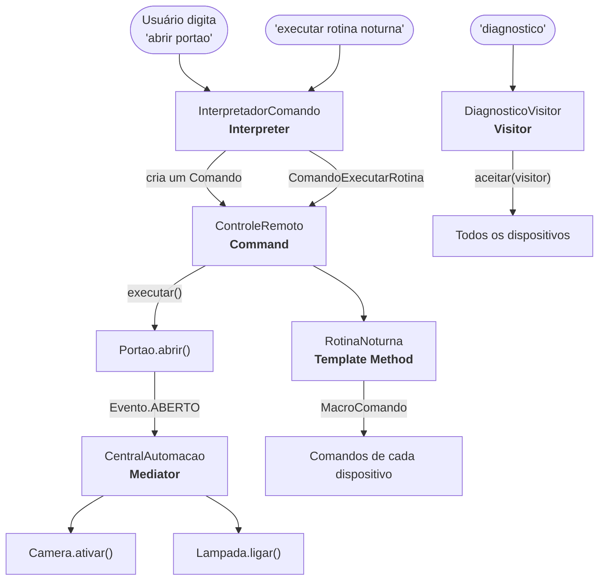
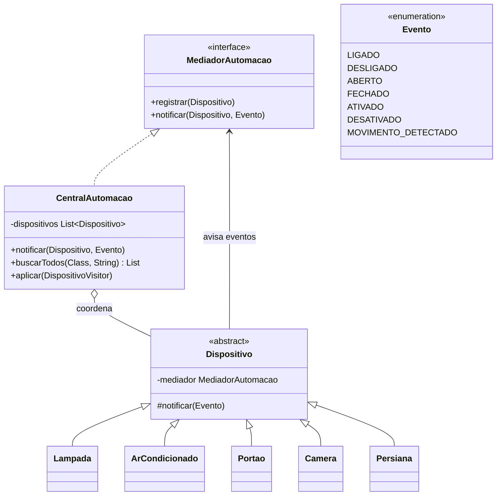
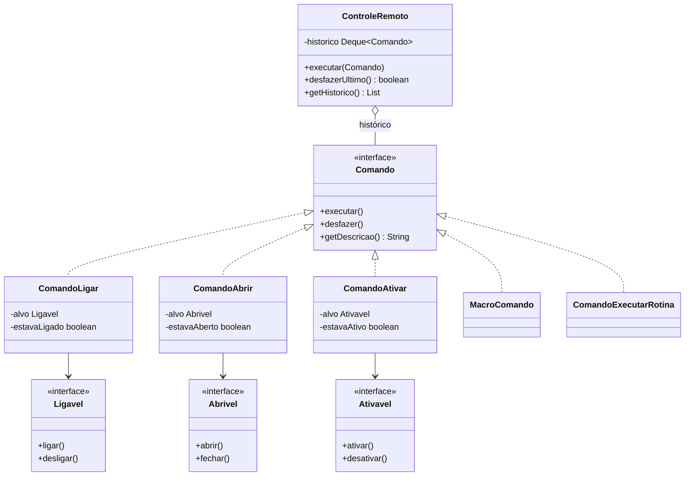
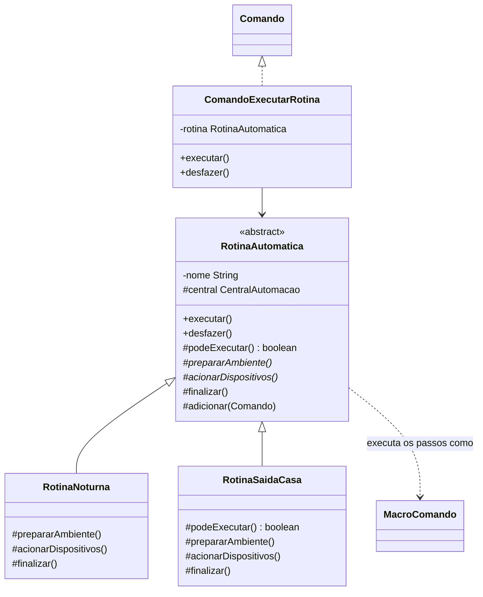
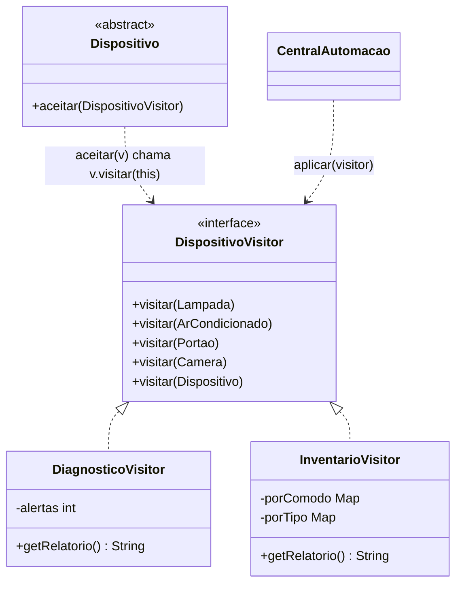
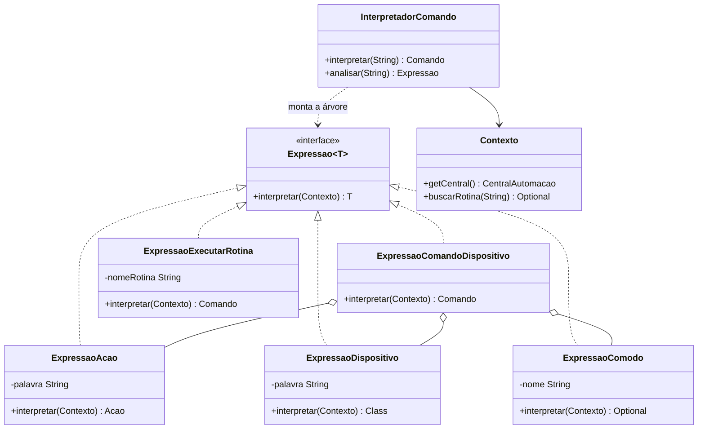
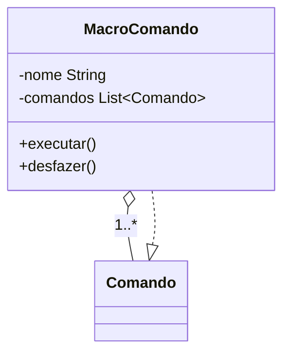

# Automação Residencial

Projeto da disciplina **Padrões de Projeto** (IFTO – CST em Sistemas para Internet).

Sistema de automação residencial em Java que controla dispositivos (lâmpadas, ar-condicionado, portão, câmera e persiana), executa comandos e rotinas automáticas e entende comandos digitados em texto, como `ligar luz sala`.

O objetivo é mostrar como os dispositivos colaboram **sem se conhecerem diretamente** e como novos comportamentos entram **sem mexer no que já existe**, usando cinco padrões de projeto:

| Padrão | Onde está | Para quê |
|---|---|---|
| **Mediator** | `automacao.mediator` | Centralizar a comunicação entre dispositivos |
| **Command** | `automacao.comando` | Representar ações (ligar, abrir, ativar...) como objetos que podem ser desfeitos |
| **Template Method** | `automacao.rotina` | Fixar o roteiro das rotinas automáticas e variar só os passos |
| **Visitor** | `automacao.visitor` | Executar operações (diagnóstico, inventário) sobre todos os dispositivos sem alterá-los |
| **Interpreter** | `automacao.interpretador` | Interpretar comandos textuais digitados pelo usuário |

---

## Sumário

- [Usando o sistema](#usando-o-sistema)
- [Estrutura de pacotes](#estrutura-de-pacotes)
- [Visão geral: como os padrões trabalham juntos](#visão-geral-como-os-padrões-trabalham-juntos)
- [Padrões aplicados](#padrões-aplicados)
  - [Mediator](#mediator)
  - [Command](#command)
  - [Template Method](#template-method)
  - [Visitor](#visitor)
  - [Interpreter](#interpreter)
- [Desafio adicional: macro de comandos com desfazer](#desafio-adicional-macro-de-comandos-com-desfazer)
- [Mudança de requisito: novo dispositivo Persiana](#mudança-de-requisito-novo-dispositivo-persiana)
- [Histórico de desenvolvimento](#histórico-de-desenvolvimento)

---


## Usando o sistema

A casa já começa montada com estes dispositivos:

| Cômodo | Dispositivos |
|---|---|
| sala | lâmpada, ar-condicionado, persiana |
| quarto | lâmpada, ar-condicionado, persiana |
| garagem | lâmpada, portão, câmera |

### Comandos de texto (Interpreter)

Formato: `<ação> <dispositivo> [cômodo]`. Acentos, maiúsculas e palavras como "o", "do" e "da" são ignorados.

```
ligar luz sala
abrir portao
desligar ar quarto
Ligar o Ar-Condicionado do Quarto
ativar camera garagem
fechar persiana quarto
acender luz                 (sem cômodo: age em todas as luzes)
executar rotina noturna
executar rotina saida
```

Ações: `ligar`/`acender`, `desligar`/`apagar`, `abrir`, `fechar`, `ativar`, `desativar`.
Dispositivos: `luz`/`lampada`, `ar`, `portao`, `camera`, `persiana`.

### Comandos do sistema

| Comando | O que faz |
|---|---|
| `status` | Mostra o estado de todos os dispositivos |
| `historico` | Lista os comandos executados (mais recente primeiro) |
| `desfazer` | Desfaz o último comando, macro ou rotina |
| `diagnostico` | Verifica problemas na casa (Visitor) |
| `inventario` | Lista os dispositivos por cômodo e por tipo (Visitor) |
| `movimento <cômodo>` | Simula o sensor da câmera (dispara o Mediator) |
| `ajuda` | Mostra a ajuda |
| `sair` | Encerra o programa |

### Exemplo de sessão

```
> abrir portao
[Controle] executando: abrir Portão (garagem)
[Portão (garagem)] aberto
[Central] portão da garagem aberto: ativando câmeras e acendendo luzes do local
[Câmera (garagem)] ativada, gravando
[Lâmpada (garagem)] ligada

> diagnostico
Diagnóstico da casa
  ...
  [ALERTA] Portão (garagem) - aberto -> portão aberto, casa vulnerável
  ...

> desfazer
[Controle] desfazendo: abrir Portão (garagem)
[Portão (garagem)] fechado
[Central] portão da garagem fechado: apagando luzes do local
[Lâmpada (garagem)] desligada
```

---

## Estrutura de pacotes

```
src/main/java/automacao/
├── Main.java                    monta a casa e abre o console
├── ConsoleAutomacao.java        laço de leitura do terminal
├── dispositivo/                 Dispositivo, Lampada, ArCondicionado, Portao, Camera, Persiana
│                                interfaces de capacidade: Ligavel, Abrivel, Ativavel
├── mediator/                    MediadorAutomacao, CentralAutomacao, Evento
├── comando/                     Comando, ComandoLigar/Desligar, ComandoAbrir/Fechar,
│                                ComandoAtivar/Desativar, MacroComando, ControleRemoto
├── rotina/                      RotinaAutomatica, RotinaNoturna, RotinaSaidaCasa,
│                                ComandoExecutarRotina
├── visitor/                     DispositivoVisitor, DiagnosticoVisitor, InventarioVisitor
└── interpretador/               InterpretadorComando, Expressao, ExpressaoAcao,
                                 ExpressaoDispositivo, ExpressaoComodo,
                                 ExpressaoComandoDispositivo, ExpressaoExecutarRotina,
                                 Contexto, Acao, ComandoInvalidoException
```

Os dispositivos são agrupados por **capacidade** (`Ligavel`, `Abrivel`, `Ativavel`) e não por tipo concreto. Os comandos dependem dessas interfaces, por isso um dispositivo novo que "abre e fecha" já ganha `ComandoAbrir` e `ComandoFechar` sem nenhuma linha extra.

---

## Visão geral: como os padrões trabalham juntos



O **Interpreter** transforma texto em **Command**. O controle executa o comando e guarda o histórico. O dispositivo muda de estado e avisa o **Mediator**, que aciona os outros dispositivos. As rotinas (**Template Method**) também viram comandos, então podem ser desfeitas. O **Visitor** percorre a casa para gerar relatórios.

---

## Padrões aplicados

Para cada padrão: **o problema que existia antes**, **por que o padrão foi escolhido** e **qual melhoria ele trouxe**.

### Mediator

**Problema antes.** Os dispositivos precisam reagir uns aos outros: abrir o portão deve ligar a câmera e a luz da garagem; a câmera detectar movimento deve acender a luz. Sem um mediador, cada dispositivo guarda referências aos outros e os chama diretamente:

```java
// sem o padrão
public class Portao {
    private Camera camera;
    private Lampada luzGaragem;
    private List<ArCondicionado> ares;

    public void abrir() {
        aberto = true;
        camera.ativar();
        luzGaragem.ligar();
        for (ArCondicionado ar : ares) { ... }
    }
}
```

Cada regra nova cria mais um acoplamento. Com N dispositivos, as ligações crescem perto de N², e o `Portao` passa a depender de classes que não têm nada a ver com ele.

**Por que o Mediator.** O padrão concentra a comunicação num objeto central. Os dispositivos só avisam "aconteceu X comigo"; quem decide quem reage é o mediador.

**Como foi aplicado.**
- `MediadorAutomacao`: interface com `registrar(dispositivo)` e `notificar(origem, evento)`.
- `CentralAutomacao`: mediador concreto. Guarda todos os dispositivos e todas as regras de colaboração.
- `Dispositivo`: só conhece o mediador e chama `notificar(Evento.ABERTO)`, `notificar(Evento.LIGADO)` etc. quando o estado realmente muda.

Regras implementadas na central:

| Quando | A central faz |
|---|---|
| Portão abre | Ativa as câmeras e acende as luzes do mesmo cômodo |
| Portão fecha | Apaga as luzes do mesmo cômodo |
| Câmera detecta movimento | Acende as luzes do mesmo cômodo |
| Ar-condicionado liga com algum portão aberto | Exibe um aviso |

**Melhoria.** `Portao`, `Camera` e `Lampada` não se conhecem. As regras ficam num lugar só, e uma regra nova é um método novo na central, sem mudar nenhum dispositivo.



---

### Command

**Problema antes.** Várias partes do sistema disparam ações: o console, as rotinas, o interpretador. Sem o padrão, cada uma precisa saber qual método chamar em qual classe:

```java
// sem o padrão
if (acao.equals("ligar") && dispositivo.equals("luz")) {
    lampada.ligar();
} else if (acao.equals("abrir") && dispositivo.equals("portao")) {
    portao.abrir();
} else if ...
```

Além disso, a ação não fica registrada em lugar nenhum, então **não há como desfazer**.

**Por que o Command.** O padrão transforma cada ação num objeto com `executar()` e `desfazer()`. Quem dispara não precisa saber o que a ação faz, e o objeto pode ser guardado num histórico, agrupado ou executado depois.

**Como foi aplicado.**
- `Comando`: interface com `executar()`, `desfazer()` e `getDescricao()`.
- Comandos concretos: `ComandoLigar`, `ComandoDesligar`, `ComandoAbrir`, `ComandoFechar`, `ComandoAtivar`, `ComandoDesativar`. Cada um guarda o estado anterior para desfazer só o que realmente mudou.
- Os comandos dependem das interfaces `Ligavel`, `Abrivel` e `Ativavel`, não das classes concretas. `ComandoLigar` funciona com lâmpada, ar-condicionado e qualquer dispositivo ligável futuro.
- `ControleRemoto`: invoker. Executa qualquer comando e guarda uma pilha de histórico para `desfazerUltimo()`.

**Melhoria.** Console, rotinas e interpretador falam todos a mesma "língua" (`Comando`). Desfazer passou a ser possível. Macros e rotinas viraram simples composições de comandos.



*`ComandoDesligar`, `ComandoFechar` e `ComandoDesativar` seguem a mesma estrutura e foram omitidos do diagrama.*

---

### Template Method

**Problema antes.** As rotinas automáticas (noturna, saída de casa) seguem sempre o mesmo roteiro: verificar se podem rodar, preparar o ambiente, acionar dispositivos e finalizar. Sem o padrão, cada rotina reescreve esse roteiro inteiro:

```java
// sem o padrão
public class RotinaNoturna {
    public void executar() {
        System.out.println("iniciando");
        // apaga luzes, fecha portões...
        // ativa câmeras, liga ar do quarto...
        System.out.println("concluída");
    }
}
public class RotinaSaidaCasa {
    public void executar() {
        System.out.println("iniciando");   // repetido
        // ...
        System.out.println("concluída");   // repetido
    }
}
```

O roteiro fica duplicado, uma rotina pode esquecer um passo, e mudar a ordem exige mexer em todas.

**Por que o Template Method.** O padrão fixa o algoritmo num método da superclasse e deixa as subclasses implementarem só os passos que variam.

**Como foi aplicado.**
- `RotinaAutomatica.executar()` é `final` e define a ordem:
  1. `podeExecutar()`: *hook*, por padrão retorna `true`
  2. `prepararAmbiente()`: abstrato
  3. `acionarDispositivos()`: abstrato
  4. `finalizar()`: *hook*, por padrão registra "concluída"
- Os passos não acionam nada direto: chamam `adicionar(comando)`. No fim, a rotina executa tudo como um `MacroComando`, por isso a rotina inteira pode ser desfeita.
- `RotinaNoturna`: apaga as luzes, desliga os ares fora do quarto, fecha os portões, ativa as câmeras e liga o ar do quarto.
- `RotinaSaidaCasa`: desliga luzes e ares, fecha os portões e ativa as câmeras. Sobrescreve o hook `podeExecutar()` para **cancelar** a rotina se não houver câmera na casa.
- `ComandoExecutarRotina`: adapta a rotina para `Comando`, então o `ControleRemoto` executa e desfaz rotinas como qualquer ação.

**Melhoria.** O roteiro existe uma vez só e não pode ser quebrado pelas subclasses (`final`). Uma rotina nova (por exemplo, `RotinaFerias`) implementa só dois métodos.



*`executar()` e `desfazer()` são `final`. Métodos com `*` são abstratos.*

---

### Visitor

**Problema antes.** Queremos operações sobre todos os dispositivos: diagnóstico (encontrar problemas) e inventário (listar por cômodo). Sem o padrão, há dois caminhos ruins:

```java
// sem o padrão, opção 1: um método novo em cada dispositivo
public abstract class Dispositivo {
    public abstract String diagnosticar();
    public abstract String inventariar();
    public abstract double calcularConsumo();   // e a próxima operação...
}

// sem o padrão, opção 2: instanceof espalhado
for (Dispositivo d : dispositivos) {
    if (d instanceof Portao p && p.isAberto()) { ... }
    else if (d instanceof Camera c && !c.isAtivo()) { ... }
    else if ...
}
```

Na opção 1, cada operação nova obriga a alterar **todas** as classes de dispositivo. Na opção 2, a lógica fica espalhada e frágil.

**Por que o Visitor.** O padrão separa a operação da estrutura: cada operação vira uma classe "visitante" com um método por tipo de dispositivo, e o dispositivo só precisa saber `aceitar(visitor)`.

**Como foi aplicado.**
- `DispositivoVisitor`: um `visitar(...)` para cada dispositivo e um `visitar(Dispositivo)` genérico como alternativa.
- `Dispositivo.aceitar(visitor)` faz o *double dispatch*: cada dispositivo chama `visitor.visitar(this)`, e o Java escolhe o método certo pelo tipo.
- `DiagnosticoVisitor`: alerta para ar ligado abaixo de 18 °C, portão aberto e câmera desativada.
- `InventarioVisitor`: agrupa os dispositivos por cômodo e conta por tipo.
- `CentralAutomacao.aplicar(visitor)` percorre todos os dispositivos.

**Melhoria.** Uma operação nova (por exemplo, consumo de energia) é **uma classe nova**, sem tocar nos dispositivos. E graças ao `visitar(Dispositivo)` genérico, um dispositivo novo aparece nos relatórios mesmo antes de alguém escrever um método específico para ele (veja a [mudança de requisito](#mudança-de-requisito-novo-dispositivo-persiana)).



---

### Interpreter

**Problema antes.** O usuário digita frases como `ligar luz sala` ou `executar rotina noturna`. Sem o padrão, a leitura vira um bloco gigante de `if/else` com todas as combinações:

```java
// sem o padrão
if (texto.equals("ligar luz sala")) { ... }
else if (texto.equals("ligar luz quarto")) { ... }
else if (texto.equals("acender luz sala")) { ... }
else if (texto.startsWith("executar rotina")) { ... }
// uma linha para cada combinação de ação x dispositivo x cômodo
```

Adicionar um sinônimo, um cômodo ou um dispositivo multiplica os casos.

**Por que o Interpreter.** O padrão define uma gramática simples e representa cada parte dela por uma classe. A frase vira uma pequena árvore de expressões que se interpreta sozinha.

**Gramática.**

```
comando           ::= comandoDispositivo | executarRotina
comandoDispositivo ::= acao dispositivo [comodo]
executarRotina    ::= "executar" "rotina" nome
acao              ::= "ligar" | "acender" | "desligar" | "apagar" | "abrir" | "fechar" | "ativar" | "desativar"
dispositivo       ::= "luz" | "lampada" | "ar" | "portao" | "camera" | "persiana"
```

**Como foi aplicado.**
- `Expressao<T>`: interface com `interpretar(contexto)`.
- Expressões **terminais**: `ExpressaoAcao` (palavra para `Acao`), `ExpressaoDispositivo` (palavra para tipo de dispositivo) e `ExpressaoComodo`.
- Expressões **não terminais**: `ExpressaoComandoDispositivo` (combina ação, dispositivo e cômodo e devolve um `Comando`) e `ExpressaoExecutarRotina` (devolve um `ComandoExecutarRotina`).
- `Contexto`: dá acesso à central e às rotinas registradas.
- `InterpretadorComando`: normaliza o texto (acentos, maiúsculas, hífens, palavras como "o", "do", "da") e monta a árvore.
- Sem cômodo, a expressão age em todos os dispositivos do tipo: `acender luz` vira um `MacroComando`.
- Erros (ação desconhecida, dispositivo que não suporta a ação, cômodo sem dispositivo) geram `ComandoInvalidoException` com mensagem clara.

**Melhoria.** Cada parte da frase é uma classe pequena e testável. Um sinônimo ou dispositivo novo é **uma entrada no vocabulário** da expressão terminal. Como o resultado da interpretação é um `Comando`, todo comando digitado pode ser desfeito.



---

## Desafio adicional: macro de comandos com desfazer

`MacroComando` implementa `Comando` e guarda uma lista de comandos:

- `executar()` roda os comandos **na ordem**;
- `desfazer()` desfaz os comandos **na ordem inversa**.

Como a macro também é um `Comando`, o `ControleRemoto` não precisou de nenhuma mudança: `desfazer` no console desfaz a macro inteira como uma única operação. O mesmo mecanismo é usado pelas rotinas e por comandos de texto sem cômodo (`acender luz`).



Cada comando guarda o estado anterior do dispositivo, então desfazer restaura exatamente o que estava antes. Se a luz já estava ligada, desfazer "ligar luz" não a desliga.

---

## Mudança de requisito: novo dispositivo Persiana

**Novo requisito:** controlar persianas na sala e no quarto.

Arquivos alterados para atender o requisito:

| Arquivo | Mudança |
|---|---|
| `dispositivo/Persiana.java` | **classe nova** (`extends Dispositivo implements Abrivel`) |
| `interpretador/ExpressaoDispositivo.java` | **1 linha**: `"persiana"` no vocabulário |
| `Main.java` | registra duas persianas na casa |

Nenhuma outra classe foi alterada, e a persiana já funciona com todos os padrões:

- **Command:** como implementa `Abrivel`, reaproveita `ComandoAbrir` e `ComandoFechar`, inclusive com desfazer.
- **Interpreter:** `abrir persiana sala` funciona; `abrir persiana` abre todas numa macro; `ligar persiana` é recusado com mensagem clara.
- **Visitor:** aparece no inventário e no diagnóstico pelo `visitar(Dispositivo)` genérico, sem alterar nenhum visitor.
- **Mediator:** avisa a central ao abrir e fechar. Uma regra nova para a persiana seria um método novo só na `CentralAutomacao`.
- **Template Method:** uma rotina pode passar a usar persianas sobrescrevendo apenas os passos dela.

O commit dessa mudança está na branch `feature/novo-dispositivo`.

---

## Histórico de desenvolvimento

O projeto foi construído em etapas, cada uma numa branch própria e integrada à `main` por pull request:

| Etapa | Branch | Conteúdo |
|---|---|---|
| 1 | `feature/dispositivos-base` | Dispositivos e interfaces de capacidade |
| 2 | `feature/mediator` | Mediator com `CentralAutomacao` |
| 3 | `feature/command` | Comandos e `ControleRemoto` com histórico |
| 4 | `feature/macro-comando` | `MacroComando` com desfazer (desafio adicional) |
| 5 | `feature/rotinas` | Rotinas com Template Method |
| 6 | `feature/visitor` | Visitors de diagnóstico e inventário |
| 7 | `feature/interpreter` | Interpretador de comandos textuais |
| 8 | `feature/console` | Console interativo |
| 9 | `feature/novo-dispositivo` | Mudança de requisito: Persiana |
| 10 | `feature/readme-uml` | Documentação e diagramas UML |
